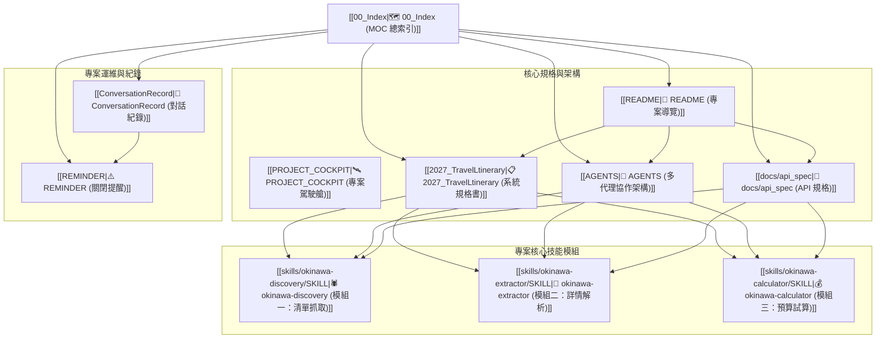

# 🗺️ 2027 春節沖繩旅遊跨社比價與監控系統 — 知識圖譜索引 (MOC)

> **專案代號**：`okinawa-lny2027-tracker`  
> **核心目標**：針對 **2027 年農曆春節連假區間（2027-02-01 至 2027-02-14）**，自動化追蹤臺灣五大旅行社（可樂、東南、雄獅、山富、世邦）的沖繩 5 天（含）以下團體行程與 Google Flights 同期直飛機票基準價，並依家族成員結構計算真實總預算與每日異常告警。

---

## 🧭 知識圖譜架構導覽 (Graph Overview)

---

## 📑 核心文檔目錄 (Core Documents)

| 文檔名稱 | Obsidian 連結 | 類型 | 說明 |
|---------|--------------|------|------|
| **專案駕駛艙** | [[PROJECT_COCKPIT]] | `project-cockpit` | 專案即時狀態、本機與 GitHub 路徑、已完成里程碑與模組總覽 |
| **專案首頁** | [[README]] | `documentation` | 專案簡介、技術堆疊、快速上手與架構索引 |
| **系統計畫規格書** | [[2027_TravelLtinerary]] | `specification` | 最高指導藍圖，涵蓋業務背景、系統資料流、四階段里程碑與 Pydantic 核心資料模型 |
| **AI 多代理架構** | [[AGENTS]] | `agent-manifest` | 5 大 Agent (Orchestrator, Backend, Database, QA, Docs) 角色定義、路由演算法與防呆紅線 |
| **API 與資料交互規格** | [[docs/api_spec]] | `api-spec` | FastAPI 端點規格 (`POST /daily-run`, `GET /health`)、排程交互與 SQLite 表結構約束 |
| **對話紀錄歷程** | [[ConversationRecord]] | `log` | 專案對話歷史記錄與決策上下文追蹤 |
| **更新提醒事項** | [[REMINDER]] | `guide` | 關閉專案前對話記錄更新與 GitHub 推送提醒 |

---

## 🧩 專案核心模組與 Skills 索引

系統由三大業務模組構成，均配有專屬的 Antigravity Skill 指引：

### 1. 模組一：清單自動撈取引擎 (`src/discovery/`)
- **說明文件**：[[skills/okinawa-discovery/SKILL|okinawa-discovery (清單抓取規範)]]
- **核心定位**：五大旅行社（雄獅、可樂、東南、山富、世邦）上游清單撈取。
- **技術架構**：雙模式容錯（Mode A Direct XHR Replay `< 2s` + Mode B Playwright Network Interception），正規化輸出 `TourListItem`。
- **關聯文檔**：[[2027_TravelLtinerary]] 第 3.1 節、[[AGENTS]] Backend 職責、[[docs/api_spec]] 核心約束。

### 2. 模組二：詳情頁結構化解析與機票基準 (`src/extractor/`)
- **說明文件**：[[skills/okinawa-extractor/SKILL|okinawa-extractor (詳情頁解析規範)]]
- **核心定位**：Crawl4AI + LLM（Gemini 2.5 Flash / Ollama Qwen2.5 14b）非結構化抽取 + fast-flights 直飛機票基準。
- **關鍵機制**：**兩段式增量解析**（未超過 7 天不重複呼叫 LLM，節省 90% Token 成本）。
- **關聯文檔**：[[2027_TravelLtinerary]] 第 3.2 節、[[AGENTS]] Backend 職責、[[docs/api_spec]] SQLite 資料表。

### 3. 模組三：家族總預算試算與異動告警 (`src/calculator/`)
- **說明文件**：[[skills/okinawa-calculator/SKILL|okinawa-calculator (預算試算與告警規範)]]
- **核心定位**：讀取 `config/family_profile.yaml`，處理日本「滿 6 歲強制佔床」、導領小費乘算、單人房差、剩餘機位檢核與長輩/購物風險評分。
- **告警引擎**：比對 `price_snapshots` 歷史快照，偵測調價、低機位與新團事件，供 n8n 觸發推播。
- **關聯文檔**：[[2027_TravelLtinerary]] 第 3.3 節、[[AGENTS]] QA 測試規範、[[docs/api_spec]] Daily Run 回應格式。

---

## 👥 AI 代理角色分工 (Agent Matrix)

詳細定義請參閱 [[AGENTS]]：

| Agent 名稱 | 角色 | 職責簡述 | 主要對應模組 / 技能 |
|-----------|------|---------|-------------------|
| **agent-orchestrator** | COORDINATOR | 任務拆解、DAG 排程分派與跨層協調，絕不直接寫程式碼 | [[AGENTS]], [[00_Index]] |
| **agent-backend** | IMPLEMENTER (Service) | 實作 FastAPI 端點、五大旅行社 Adapter、Crawl4AI 解析與預算引擎 | [[skills/okinawa-discovery/SKILL]], [[skills/okinawa-extractor/SKILL]], [[skills/okinawa-calculator/SKILL]] |
| **agent-database** | IMPLEMENTER (Data) | SQLite 3 連線管理、DDL 初始化與 Repository 冪等寫入 | [[docs/api_spec]], [[2027_TravelLtinerary]] |
| **agent-qa** | VALIDATOR | pytest 單元測試、XHR 封包檢驗與計價/告警邏輯驗證 | [[skills/okinawa-calculator/SKILL]], [[2027_TravelLtinerary]] |
| **agent-docs** | DOCUMENTER | 維護規格文件、api_spec.md、README.md、Skills 與 Obsidian 圖譜 | [[README]], [[docs/api_spec]], [[00_Index]] |

---

## 🏷️ 標籤分類索引 (Tag Taxonomy)

在 Obsidian 標籤面板中可透過以下標籤檢索：
- `#moc`：知識圖譜中心索引節點（[[00_Index]]）
- `#specification`：系統架構規格書（[[2027_TravelLtinerary]]）
- `#agent-orchestration`：AI 代理協作與路由規則（[[AGENTS]]）
- `#api`：API 端點與通訊協議規範（[[docs/api_spec]]）
- `#skill`：專案專屬執行技能（[[skills/okinawa-discovery/SKILL]], [[skills/okinawa-extractor/SKILL]], [[skills/okinawa-calculator/SKILL]]）
- `#crawler`：爬蟲與網路請求相關實作（[[skills/okinawa-discovery/SKILL]]）
- `#llm`：LLM 結構化抽取與提示詞相關（[[skills/okinawa-extractor/SKILL]]）
- `#budget`：財務預算、小費與房差計算（[[skills/okinawa-calculator/SKILL]]）
- `#conversation-log`：對話記錄與歷史維護（[[ConversationRecord]], [[REMINDER]]）

---

> 🔄 **雙向鏈結維護準則**：任何新增文檔或規格變更，皆需於本索引同步更新，並確保所有檔案頂部具備標準 YAML frontmatter。
